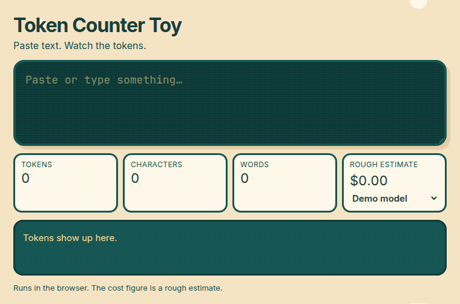

# Token Counter Toy

Paste text and watch it split into colored token chips, right in your browser.

**Live demo:** https://tommithetechie.github.io/token-counter-toy/



## What it does

You type or paste text. The page splits it into tokens, draws each token as a colored chip, and shows:

- token count
- character count
- word count
- a rough cost estimate for the model you pick

There is no account and no backend.

## How tokens work

A model does not read one letter at a time, and it does not simply count words. It reads **tokens**: short chunks from a fixed vocabulary. A small word is often one token. A longer word may be several. Spaces and punctuation are chunks too. The same sentence can be a different number of tokens under a different vocabulary.

This page uses a real tokenizer in the browser, so the chips follow that split.

## Nothing is uploaded

The toy is a static page. After it loads, counting happens on your machine. The text you paste is not uploaded.

## Cost is a rough estimate

The dollar figure is token count times a published input price per million tokens. It is a sketch, not a bill. A real charge depends on the model, on input versus output, and on the price that day. Treat the number as a ballpark.

## Run it

There is no build step.

GitHub Pages serves the `main` branch from the repository root at the live demo link above.

On your machine, start any static file server from the repo root and open the URL it prints. For example:

```bash
python3 -m http.server 8080
```

Then visit http://localhost:8080/

Use a static server rather than opening the file directly, so the page can load its modules.

## File layout

| Path | What it is |
| --- | --- |
| `index.html` | Page shell |
| `css/base.css` | Layout |
| `css/crt.css` | Retro CRT styling |
| `js/app.js` | Wires the page together |
| `js/tokenizer.js` | In-browser tokenizer |
| `js/chips.js` | Colored token chips |
| `js/stats.js` | Counts and the rough cost |
| `js/pricing.js` | Input prices used for that estimate |
| `.nojekyll` | Tells GitHub Pages to serve the files as they are |
| `docs/demo.gif` | Short demo |
| `tools/` | Script that records the demo GIF |
| `LICENSE` | MIT |

## Record the demo

`tools/record-demo.mjs` serves this repo, types a sample into the text box, and writes `docs/demo.gif`. The recorder is only for making that clip. You do not need it to use the toy.

```bash
cd tools
npm install
npx playwright install chromium
cd ..
node tools/record-demo.mjs
```

`ffmpeg` needs to be on your PATH. The script serves this repo and opens `index.html`.

## Credits

Token splitting uses [gpt-tokenizer](https://github.com/niieani/gpt-tokenizer) (MIT), in the browser, with the `o200k_base` encoding.

## License

MIT. See [LICENSE](LICENSE).
